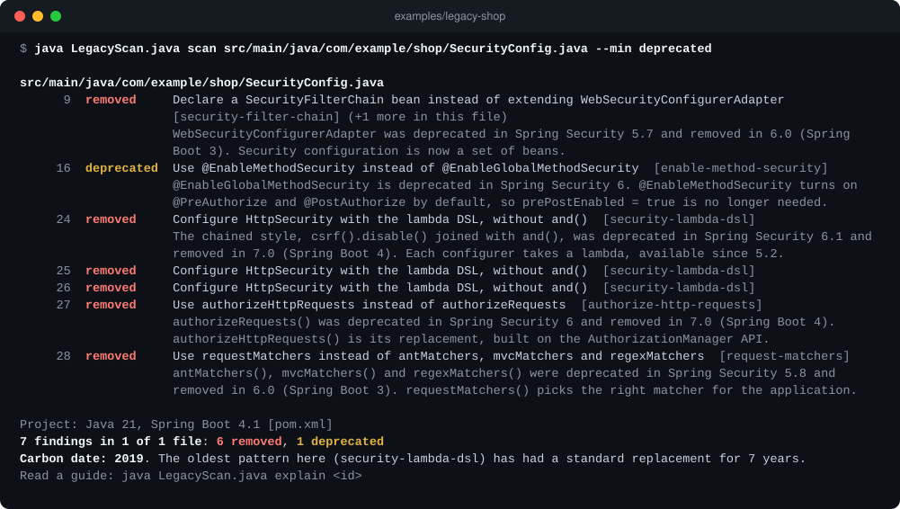

# modern-java-guidance

**Get your coding agent off 2014 Java.**

[](https://github.com/venumittapalli576/modern-java-guidance/actions/workflows/ci.yml)
[](LICENSE)
[](skills/modern-java-guidance/INDEX.md)
[](#the-scanner)

Most Java ever published was written for Java 8 and Spring Boot 1 or 2, and that is what a coding agent has read the most of. Ask one for a Spring Boot service and you get `javax.persistence`, `WebSecurityConfigurerAdapter`, `RestTemplate`, `@MockBean`, JUnit 4 and a Dockerfile with `-XX:MaxPermSize`. On Spring Boot 4 and Java 25, half of that does not compile and some of it stops the JVM from starting.

This repository is three things that fix it:

- **100 guides**, each one legacy pattern with its current replacement, the version where the replacement arrived, and the version where the old form was deprecated or removed.
- **A scanner** that enforces the same guides. It is one Java file with no dependencies. If you have a JDK, you can run it.
- **An agent skill and a Claude Code hook**, so the agent writes the current form and gets corrected on the lines it just wrote.



## Try it in a minute

You need a JDK 17 or later. Nothing is installed and nothing leaves your machine.

```sh
git clone --depth 1 https://github.com/venumittapalli576/modern-java-guidance
java modern-java-guidance/skills/modern-java-guidance/scripts/LegacyScan.java scan /path/to/your/project
```

The scanner reads the Java level and Spring Boot version from your `pom.xml` or `build.gradle` and reports only what applies to them. On a Spring Boot 2.7 project it will not tell you to use `jakarta.*`. To see what an upgrade would break, ask:

```sh
java .../LegacyScan.java scan . --boot 4.0 --java 25 --min deprecated
```

## Install it for your agent

**Claude Code**, with the hook that checks every edit:

```
/plugin marketplace add venumittapalli576/modern-java-guidance
/plugin install modern-java-guidance@modern-java-guidance
```

**Codex, Cursor, Copilot, Gemini CLI and other agents that load skills:**

```sh
npx skills add venumittapalli576/modern-java-guidance
```

**By hand:** copy `skills/modern-java-guidance/` into your agent's skills directory, for example `.claude/skills/` or `.agents/skills/`. The folder is self-contained: the guides, the index and the scanner travel together.

## What the agent sees

With the Claude Code plugin installed, the agent writes a file and the hook answers. The first run compiles the scanner, which takes about two seconds. After that it answers in about 0.2 seconds. This is the real message for the security configuration in [`examples/legacy-shop`](examples/legacy-shop), with the explanations shortened here:

```
modern-java-guidance: 6 legacy patterns in what you just wrote to SecurityConfig.java (project: Java 21, Spring Boot 4.1).
- line 9 (and 1 more) [removed] Declare a SecurityFilterChain bean instead of extending WebSecurityConfigurerAdapter. ...
- line 16 [deprecated] Use @EnableMethodSecurity instead of @EnableGlobalMethodSecurity. ...
- line 19 [superseded] Inject dependencies through the constructor, not @Autowired fields. ...
- lines 24, 25, 26 [removed] Configure HttpSecurity with the lambda DSL, without and(). The chained style,
  csrf().disable() joined with and(), was deprecated in Spring Security 6.1 and removed in 7.0 (Spring Boot 4).
  Each configurer takes a lambda, available since 5.2. (guide: security-lambda-dsl)
- line 27 [removed] Use authorizeHttpRequests instead of authorizeRequests. ...
- line 28 [removed] Use requestMatchers instead of antMatchers, mvcMatchers and regexMatchers. ...
Fix these before moving on. Each guide has a full before and after:
  .../guides/spring-security/security-filter-chain.md
  .../guides/spring-security/security-lambda-dsl.md
  ...
If a pattern is deliberate, keep it and add a comment on that line: // modern-java:ignore <id> <reason>
```

Three properties matter here:

- **It only looks at the lines the agent just wrote.** Editing one method in a legacy class does not produce a wall of complaints about the rest of the file, and does not tempt the agent into rewriting code nobody asked it to touch.
- **It knows the project's versions.** The same `@MockBean` is fine on Boot 3.3, deprecated on 3.4 and removed on 4.0, and the hook says which.
- **It cannot break your session.** No JDK, bad input or an internal error all end in a silent exit.

## What it covers

100 guides in 16 categories. The full list, with statuses and version ranges, is in [INDEX.md](skills/modern-java-guidance/INDEX.md).

| Area | Examples |
|---|---|
| Jakarta EE | `javax.persistence`, `javax.servlet`, `javax.validation` to `jakarta.*`, without touching the `javax` packages that belong to the JDK |
| Spring Security 6 and 7 | `WebSecurityConfigurerAdapter`, `authorizeRequests`, `antMatchers`, the `and()` DSL, `@EnableGlobalMethodSecurity`, the old OAuth2 annotations |
| Spring Boot 3 and 4 | Renamed starters, moved test slice packages, `@MockBean`, removed Undertow, renamed configuration keys that are silently ignored, `spring.factories` |
| Spring Web | `RestTemplate` to `RestClient`, `WebClient.block()`, Feign to HTTP service clients, Springfox to springdoc, problem details |
| Data | Hibernate 6 and 7 removals (`@Type(type=...)`, `@Where`, versioned dialects, legacy Criteria), `getOne`, Lombok `@Data` on entities |
| Jackson 3 | `com.fasterxml.jackson.databind` to `tools.jackson`, and the annotations that did not move |
| Testing | JUnit 4 to Jupiter, `@MockitoBean`, `RestTestClient`, `@ServiceConnection` |
| Java language | Records, pattern matching, switch expressions, text blocks, sequenced collections, `Stream.toList()` |
| JDK APIs | `java.time`, the HTTP client, `DatatypeConverter`, Nashorn, `new URL`, `new Locale`, wrapper constructors, the Security Manager |
| Concurrency | Virtual threads, scoped values, and what is still a preview |
| Runtime | 36 JVM flags that stop a current JVM from starting, deprecated container base images |
| Build | `maven.compiler.release`, removed Gradle configurations, relocated artifacts, Java 8 under a Boot 3 parent |
| Ecosystem | Zuul, Hystrix and Ribbon, Sleuth, `@StreamListener`, Kafka `ListenableFuture`, Spring Batch builder factories, JJWT 0.9, AWS SDK 1.x, Log4j 1 |

Every finding has one of four statuses:

| Status | Meaning |
|---|---|
| removed | Gone on this project's versions. It does not compile, does not start, or is silently ignored |
| deprecated | Still works, officially deprecated, usually scheduled for removal |
| hazard | Compiles and runs, but is a known source of bugs or is not what it appears to be |
| superseded | Works and is not deprecated, but there is a clearly better standard replacement |

## Things that look modern but are not

A lot of "modern Java" advice written for agents is itself out of date. These guides exist because generated code that otherwise looks current keeps getting them wrong:

- **`StructuredTaskScope` is still a preview**, in its seventh round in Java 27. Its API changed in Java 25, so the `ShutdownOnFailure` example from every Java 21 article no longer compiles.
- **String templates (`STR."..."`) were withdrawn** in Java 23. They are in no release.
- **"Replace `synchronized` with `ReentrantLock` to avoid pinning virtual threads"** was right for Java 21 to 23. Java 24 removed the problem (JEP 491), and the rewrite now only adds risk. The scanner even catches the comment that usually accompanies it.
- **Jackson's annotations did not move** to `tools.jackson`. Only databind, core and the modules did.
- **Spring Boot 4 still runs on Java 17.** An upgrade is not a reason to raise the Java level.

## The scanner

```
java LegacyScan.java scan [paths]            Scan files or directories
java LegacyScan.java scan --changed [ref]    Only lines changed since a git ref, plus new files
java LegacyScan.java scan --min deprecated   Hide the superseded tier
java LegacyScan.java scan --format github    Annotations for a pull request
java LegacyScan.java explain <id>            Print one guide
java LegacyScan.java search <words>          Find a guide by keyword
java LegacyScan.java list [category]         List every guide
java LegacyScan.java selftest                Prove every guide against its own examples
```

It scans `.java` files, `pom.xml`, Gradle builds, `application.properties` and `application.yml` (nested YAML keys are matched by their dotted path), Dockerfiles, Compose files and shell scripts. Comments and string literals are handled separately, so a mention of `RestTemplate` in a comment is not a finding.

**Carbon date.** Each guide records the year its replacement became available. The scanner ends its report with the oldest one it found:

```
42 findings in 8 of 9 files: 20 removed, 11 deprecated, 1 hazard, 10 superseded
Carbon date: 2014. The oldest pattern here (base64-and-hex) has had a standard replacement for 12 years.
```

**In CI.** The exit code is 1 when a `removed` finding exists, which you can change with `--fail-on`. To hold pull requests to "no new legacy code" without touching what is already there:

```yaml
- uses: actions/checkout@v4
  with:
    fetch-depth: 0
- run: |
    git clone --depth 1 https://github.com/venumittapalli576/modern-java-guidance "$RUNNER_TEMP/mjg"
    java "$RUNNER_TEMP/mjg/skills/modern-java-guidance/scripts/LegacyScan.java" \
      scan . --changed "origin/${{ github.base_ref }}" --format github --fail-on deprecated
```

**Suppressing a finding.** Put a comment on the line or the line above it. Say why.

```java
Date issued = new Date(); // modern-java:ignore java-time the billing SDK takes a java.util.Date
```

**When the build hides its versions.** If the Java level or Boot version comes from a parent POM the scanner cannot see, it says what it assumed. Pin them with a `.modern-java` file at the project root:

```
java=21
boot=3.5
disable=switch-expressions
```

## How it stays honest

Guidance for agents is easy to write and easy to get wrong, so this project checks itself.

- **The guides are the rules.** Each guide's front matter carries its own detection patterns. There is no second rule file to drift away from the documentation.
- **Every guide proves itself.** `selftest` checks that each guide's Before example is caught, that every detector is exercised by an example, and that every After example is clean under all 100 guides. It currently covers 126 detectors and 224 examples.
- **The After code builds.** [`examples/modern-jdk`](examples/modern-jdk) compiles with `-Xlint:deprecation,removal -Werror`, and [`examples/modern-shop`](examples/modern-shop) is a Spring Boot 4 application that CI builds and tests on JDK 25.
- **The JVM flag guides were run, not remembered.** All 36 options listed as stopping the JVM were passed to JDK 21 and observed to end in `Could not create the Java Virtual Machine`.
- **Every guide cites a primary source**: a JEP, the Spring or Hibernate migration guide, or the project's own release notes.
- **It was tried on real code** on 11 November 2026:

| Project | Files scanned | Result |
|---|---|---|
| [spring-petclinic](https://github.com/spring-projects/spring-petclinic) at `500158f` (Boot 4.1) | 79 | 6 findings, all superseded. `RestTemplate` in tests and one `collect(Collectors.toList())` |
| [jhipster-sample-app](https://github.com/jhipster/jhipster-sample-app) at `6b000b5` (Boot 4.1) | 167 | 6 findings: 2 deprecated starter names, 4 superseded |
| [apache/kafka](https://github.com/apache/kafka) at `0e67542` (not a Spring project) | 6,463 | No Spring findings. 1 deprecated import in a test fixture, 1,278 superseded. 29 seconds on two cores |

The first version of several detectors was wrong on Kafka: it flagged Kafka's own `Timer` class, `new Thread(...)` in shutdown hooks, and Jackson 2 imports in a project that has nothing to do with Spring Boot. Those were fixed before release. That is the reason the table is here.

## Limits

- **It matches patterns. It does not compile your code.** There is no type resolution, so a class of yours named `RestTemplate` would be flagged. Treat a finding as a strong hint and read the line. Detectors are deliberately narrow, and when in doubt they stay quiet.
- **For bulk migration, use [OpenRewrite](https://docs.openrewrite.org/).** It rewrites a whole codebase with full type information. This project does a different job: it keeps new code from being written the old way, and tells you where you stand.
- **Version detection reads the build file as text.** Maven parents, the Spring Boot Gradle plugin, toolchains and version catalogs are understood. Versions computed in build logic are not, and then you need `.modern-java`.
- **Tested on Linux with JDK 21.** CI adds JDK 17 and 25. The hook is a POSIX shell script. On Windows it needs the Git Bash that Claude Code already uses, and nobody has tried it there yet.
- **It will go stale too.** Spring Boot 4.2 and Spring Framework 7.1 are arriving as this is published. Guides carry versions and sources so that they can be corrected.

## Contributing

A guide is one Markdown file with a Before and an After. If you have watched an agent write something that stopped being right years ago, that is a guide. See [CONTRIBUTING.md](CONTRIBUTING.md). Corrections are as welcome as additions: if a version number or a claim here is wrong, open an issue with the source.

## Credits

The idea of version-aware guidance plus a legacy scan comes from [GoogleChrome/modern-web-guidance](https://github.com/GoogleChrome/modern-web-guidance), which does this for the web platform. This is the same idea for Java and Spring. It is an independent project and is not affiliated with Google, Oracle, Broadcom or the Spring team.

## License

[Apache License 2.0](LICENSE)
